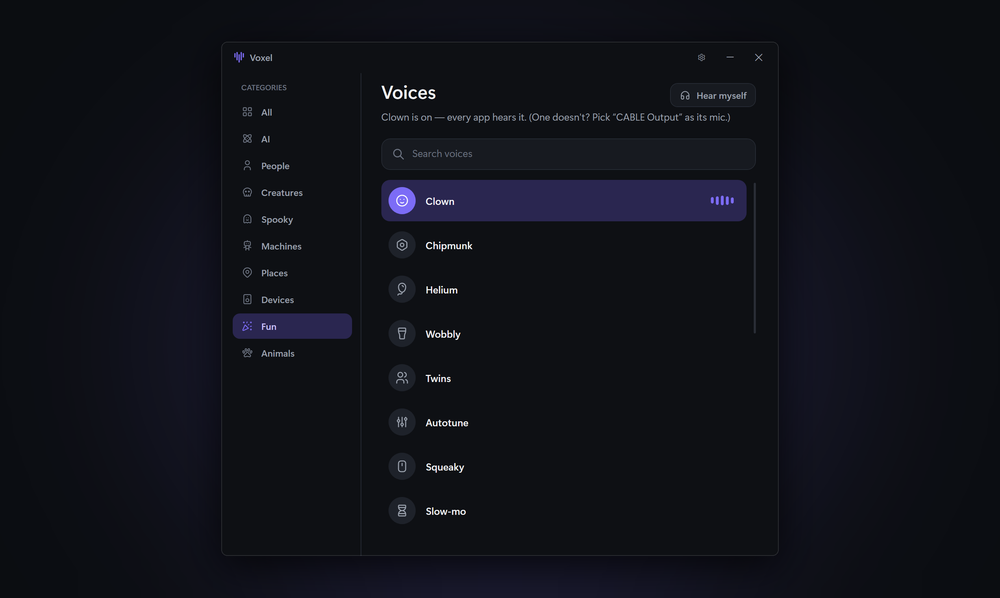

# Voxel

**Free one-click voice changer for Windows and Mac (beta).** Pick a voice and every app hears it: Discord, Telegram, games, calls. No settings to change.



## Features

- **One click.** Click a voice and it's on everywhere. Click it again to turn it off.
- **125 voices** in 9 categories: AI, People, Creatures, Spooky, Machines, Places, Devices, Fun, Animals.
- **Realistic AI voices** (Man, E-girl, Grandpa) that run live on an ordinary CPU. No graphics card needed.
- **Hear myself** to check how you sound, and a live level meter.
- **Free and open source** (MIT). No account, no ads, nothing to pay.

## Download

### Windows

Get **VoxelSetup.exe** from the [latest release](https://github.com/iamjorj/voxel/releases/latest) and run it. It installs for your user only (no admin needed) and adds Voxel to the Start menu. Nothing else to install, not even .NET. Uninstall from Windows Settings → Apps.

The first-start setup installs **VB-CABLE**, a free virtual microphone by VB-Audio, with one click. Windows asks once to allow the driver. While a voice is on, Voxel makes the virtual mic the default; it puts your real mic back when you turn the voice off or close the app.

Windows SmartScreen may warn about an unknown publisher because the installer isn't code-signed yet: choose **More info → Run anyway**.

**Updates:** when Voxel starts, it asks GitHub for the latest release and shows an **Update** button if there's a newer one. Nothing about you or your voice is sent, and nothing installs until you click it.

**An app doesn't hear the voice?** Some apps pick their own microphone. In that app's settings, choose **CABLE Output** as the microphone.

### Mac (beta)

For Macs with Apple Silicon (M1 or newer) on macOS 15 or later. Intel Macs aren't supported yet.

1. Get **Voxel-&lt;version&gt;-mac.dmg** from the [latest release](https://github.com/iamjorj/voxel/releases/latest), open it and drag **Voxel** into **Applications**.
2. Open Voxel. The first time, macOS says **"Voxel" Not Opened** because the app isn't signed with an Apple developer ID yet. Click **Done** (not Move to Trash).
3. Open **System Settings → Privacy & Security**, scroll down to the message about Voxel and click **Open Anyway**, then enter your password. You only do this once.
4. Voxel's setup installs **VB-CABLE**, the same free virtual microphone as on Windows; your Mac asks for your password. The first time you turn on a voice, click **Allow** so Voxel can use the microphone.

An app doesn't hear the voice? Choose **VB-Cable** as the microphone in that app. The Mac beta has no Update button yet: download new versions from the releases page.

## How it works

```
real mic → Voxel (AI voice → effects) → VB-CABLE → every app's mic
```

- `VoiceChanger.Core`: audio engine (NAudio, WASAPI), default-device switching, the voice catalog and the DSP effects (formant-preserving pitch shifter, vocoder, reverb and more).
- `VoiceChanger.Core/Dsp/VoiceModels.cs`: AI voices with ONNX Runtime on the CPU. **MeanVC2** turns any speaker into the voice of a 1 KB speaker file (Man, E-girl, Grandpa).
- `Voxel`: the WPF app.
- `Voxel.Setup`: the installer (per-user install, Start-menu and desktop shortcuts, entry in Windows' Apps list; `Voxel.exe --uninstall` removes it).
- `VoiceChanger.App`: test harness (`--dsptest`, `--selftest`, `--aifile`).
- `VoiceChanger.Mac`: the Mac audio layer (Core Audio devices, default-mic switching, AudioQueues) over the same effects and AI code; `install-vbcable.sh` installs VB-CABLE.
- `Voxel.Mac`: the Mac app (Avalonia), the same screens as the Windows one.
- `VoiceChanger.EngineTest`, `VoiceChanger.Mac.LiveTest`, `Voxel.Mac.Screens`: checks that run on GitHub's Macs (see `.github/workflows`), since the Mac version is built without a Mac at hand.
- `research/`: scripts that export the AI models to ONNX (`meanvc/export_meanvc.py`, `llvc_export.py`) and train LLVC voices (`train/`).

## Build

Needs Windows and the .NET 10 SDK.

```bash
dotnet build Voxel
```

Installer (Voxel's own, in `Voxel.Setup`). Writes `artifacts/VoxelSetup-<version>.exe`:

```bash
powershell -ExecutionPolicy Bypass -File installer/build.ps1
```

Mac download, on a Mac with the .NET 10 SDK. Writes `artifacts/Voxel-<version>-mac.dmg`:

```bash
sh installer/build-mac.sh
```

## Credits

VB-CABLE by VB-Audio ([www.vb-cable.com](https://www.vb-cable.com), donationware), MeanVC2 by ASLP-lab (Apache-2.0), LibriSpeech (CC BY 4.0), GLOBE / Mozilla Common Voice (CC0), ONNX Runtime, NAudio, Avalonia and Tabler Icons (MIT). Details in [docs/THIRD-PARTY.md](docs/THIRD-PARTY.md).

## License

[MIT](LICENSE)
